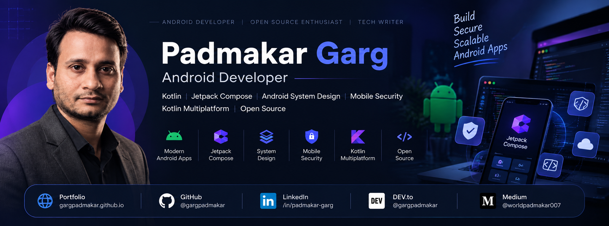
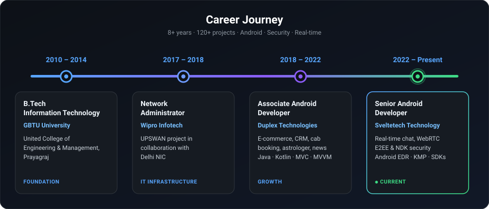

<div align="center">



# Padmakar Garg

**Senior Android Developer** · Kotlin · Jetpack Compose · System Design · Mobile Security

Building secure, scalable and production-ready Android applications, SDKs and open-source tools.

[Portfolio](https://gargpadmakar.github.io/) · [Resume](https://gargpadmakar.github.io/img/ResumePadmakar.pdf) · [LinkedIn](https://www.linkedin.com/in/padmakar-garg) · [DEV.to](https://dev.to/gargpadmakar) · [Medium](https://medium.com/@worldpadmakar007)

</div>

---

## About

Android Developer with 8+ years of experience and 120+ projects delivered across e-commerce, CRM, news, communication and security, building scalable, secure and high-performance mobile applications. I focus on products where architecture, performance, security and maintainability matter.

**Core focus**

- Native Android development with Kotlin
- Modern UI with Jetpack Compose and Material 3
- Android system design and application architecture
- Mobile application security
- Kotlin Multiplatform (KMP)
- Clean Architecture, MVVM and UseCase-driven design
- Networking, real-time communication and background processing
- Reusable Android SDKs and open-source libraries

---

## Career Journey

<div align="center">
  
</div>

### Experience

**Senior Android Developer** · Sveltetech Technology Pvt Ltd · *Aug 2022 – Present*
- Built real-time messaging with Socket programming and integrated LiveKit WebRTC for voice and video calls.
- Implemented end-to-end encryption and secure data transmission for messaging.
- Optimized app performance for smooth calls and messaging, and contributed new features with modern technologies.

**Associate Android Developer** · Duplex Technologies Services Pvt Ltd · *Jan 2018 – Jul 2022*
- Delivered e-commerce, CRM, cab booking, astrologer, service provider and news apps.
- Worked in a three-member team, owning the full project lifecycle from requirements to deployment.
- Resolved complex technical issues with an average bug resolution time under 24 hours.

**Network Administrator** · Wipro Infotech · *Oct 2017 – Oct 2018*
- Worked on the UPSWAN project in collaboration with Delhi NIC.

### Education

**B.Tech, Information Technology** · United College of Engineering & Management, Prayagraj (GBTU) · *2010 – 2014*

---

## Technical Expertise

| Area | Technologies |
|---|---|
| **Android** | Kotlin, Java, Android SDK, Jetpack Compose, Material 3, NDK (C/C++), JNI |
| **Architecture** | MVVM, Clean Architecture, UseCase, Modularization |
| **Async & Data** | Coroutines, Flow, Room, DataStore, Paging 3 |
| **Networking** | Retrofit, Ktor, REST APIs, WebSockets |
| **Real-time** | WebRTC, LiveKit, Socket.IO |
| **Security** | Encryption, authentication, secure API communication |
| **Multiplatform** | Kotlin Multiplatform (KMP) |
| **Background Work** | WorkManager, notifications, background processing |
| **Testing** | JUnit, Espresso, Mockito |
| **CI/CD** | GitHub Actions, Jenkins, Bitrise |

<div align="center">


</div>

---

## Open Source

### [ScreenAnalytics](https://github.com/gargpadmakar/screen-analytics-android) — Android Screen Analytics SDK

A library for tracking screen views and navigation analytics through a reusable, developer-friendly API.

- Screen view tracking
- Jetpack Compose support
- Library-first, reusable architecture
- Published via JitPack

### [MTProtoCrypto](https://github.com/gargpadmakar/MTProtoCrypto) — MTProto 2.0 Cryptography SDK

A Kotlin-based Android cryptography SDK implementing MTProto 2.0 primitives, with a Jetpack Compose sample app and a Node.js reference backend. Built with Clean Architecture, MVVM and the UseCase pattern. Independent project, not affiliated with Telegram.

- AES-256-IGE cipher, which standard Android JCE does not provide
- MTProto 2.0 directional key derivation (SHA-256) and message encryption with random padding
- Constant-time `msg_key` verification before plaintext is released
- 2048-bit Diffie-Hellman key exchange (RFC 3526 Group 14) with parameter validation
- Secret Chat media encryption with constant-memory 64 KB streaming for large files
- Best-effort memory zeroization of sensitive buffers
- Apache 2.0 licensed, distributed via JitPack

`Kotlin` · `Jetpack Compose` · `Koin` · `Coroutines` · `Bouncy Castle` · `Node.js`

### AppProtectGuard — Mobile Security Library

An open-source project exploring practical application protection and secure development on Android.

- Security-focused utilities
- Secure coding practices
- Reusable protection-oriented components

---

## Selected Product Work

| Product | Description | Stack |
|---|---|---|
| **SvelteShield EDR** | Enterprise Android endpoint detection and response: root, emulator and hooking (Frida, Xposed) detection, loopback-VPN traffic inspection, malicious IP/domain/APK blocking, and policy-driven enforcement | Java, C/C++ (NDK), JNI, Loopback VPN, Retrofit, OkHttp, Socket.IO |
| [**Samwad**](https://play.google.com/store/apps/details?id=com.dalmiatalk) | Secure communication app with VoIP calling, real-time chat, AES/ECDH encryption and push notifications | Kotlin, Socket.IO, LiveKit, NDK, MVVM, Room, Retrofit, Firebase |
| [**Ritam News**](https://play.google.com/store/apps/details?id=org.ritamdigital.ritam&hl=en_IN) | Cross-platform news app with personalized feeds, category browsing and short videos | Kotlin Multiplatform, Clean Architecture, MVVM, Koin, Coroutines, Flow |
| [**Simplisync**](https://play.google.com/store/apps/details?id=com.simplysync) | Lead CRM with call history tracking (status, duration) synced to backend systems in real time | Kotlin, Socket.IO, Google Maps, Room, Retrofit, Firebase, MVVM |
| [**FikFis**](https://play.google.com/store/apps/details?id=com.fikfis) | E-commerce app with secure payments, shipping APIs and push notifications | Kotlin, Retrofit, Stripe, Firebase |
| [**Super Astrologer**](https://play.google.com/store/apps/details?id=com.superastrologer) | Astrology consultation app with Exotel voice calls, payments, reminders and push notifications (10K+ downloads, 4.3★) | Java, MVC, Retrofit, Cashfree, Firebase |
| [**Edly**](https://play.google.com/store/apps/details?id=com.app.edlytech) | EdTech app for competitive exam prep with AI-powered mock tests and adaptive learning | Kotlin, MVVM, REST APIs, Google Sign-In |
| [**Cell Id**](https://play.google.com/store/apps/details?id=com.cellid) | Telecom tower search with Google Maps, clustering and Razorpay-based access control | Kotlin, MVVM, Google Maps and Places APIs, Room, Retrofit |

---

## Android System Design

I write and share practical system design topics from an Android developer's perspective:

- Application architecture and modularization
- Offline-first design
- Networking architecture and caching
- Database design
- Background processing and push notifications
- Real-time communication
- Authentication and authorization
- Encryption and key management
- Scalability, reliability and performance
- Observability and logging

**Reference architecture**

```text
┌─────────────────────────┐
│      Presentation       │
│   Compose / UI State    │
└────────────┬────────────┘
             │
┌────────────▼────────────┐
│        ViewModel        │
│     State / Events      │
└────────────┬────────────┘
             │
┌────────────▼────────────┐
│         UseCase         │
│     Business Logic      │
└────────────┬────────────┘
             │
┌────────────▼────────────┐
│       Repository        │
│  Contract / Abstraction │
└──────┬───────────┬──────┘
       │           │
┌──────▼──────┐ ┌──▼──────────────┐
│ Remote Data │ │   Local Data    │
│ REST / WS   │ │ Room / DataStore│
└─────────────┘ └─────────────────┘
```

---

## Mobile Application Security

Security is treated as an architectural concern, not an afterthought. Areas I work with:

- Symmetric and asymmetric encryption (AES, AES-IGE, ECDH and Diffie-Hellman key exchange)
- Secure API and WebSocket communication
- Authentication and secure token handling
- Key management and secure storage
- Native-layer (NDK/JNI) security: root, emulator, anti-debugging and anti-hooking detection
- Application integrity and tamper detection
- Network threat monitoring using a loopback VPN

---

## Technical Writing

I publish articles on Android architecture, system design, security and production engineering.

- **DEV.to:** [gargpadmakar](https://dev.to/gargpadmakar)
- **Medium:** [@worldpadmakar007](https://medium.com/@worldpadmakar007)
- **Portfolio:** [gargpadmakar.github.io](https://gargpadmakar.github.io/)

---

## Contact

| Platform | Link |
|---|---|
| Email | [worldpadmakar007@gmail.com](mailto:worldpadmakar007@gmail.com) |
| Portfolio | [gargpadmakar.github.io](https://gargpadmakar.github.io/) |
| Resume | [Download CV](https://gargpadmakar.github.io/img/ResumePadmakar.pdf) |
| GitHub | [github.com/gargpadmakar](https://github.com/gargpadmakar) |
| LinkedIn | [linkedin.com/in/padmakar-garg](https://www.linkedin.com/in/padmakar-garg) |
| DEV.to | [dev.to/gargpadmakar](https://dev.to/gargpadmakar) |
| Medium | [medium.com/@worldpadmakar007](https://medium.com/@worldpadmakar007) |
